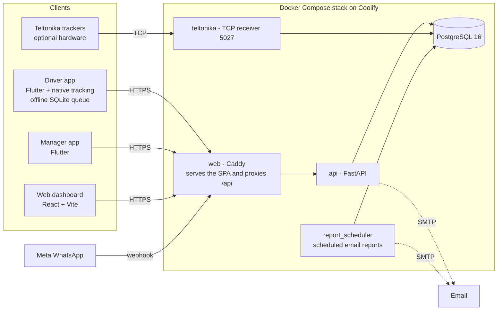

# Nuqati (نقاطي)

[](https://github.com/Riadah-Workshop/nuqati/actions/workflows/ci.yml)

Fleet and driver-safety platform by Al-Riadah Workshop. Drivers' phones record trips and safety
events; managers see them live and in reports; every driver gets a safety score. Arabic (RTL)
first, English supported.

> **Status: pilot / staging candidate.** The repository's own audits (`docs/history/`) say that
> background GPS, battery, camera and offline replay still have to be proven on physical
> devices before production use. Read [`docs/ARCHITECTURE.md`](docs/ARCHITECTURE.md) section 9
> for the known limits.

## What it does

| For | Capabilities |
|---|---|
| **Drivers** (Android app) | Automatic trip recording with GPS and offline queue; speeding, harsh acceleration / braking / cornering detection; score; Privacy Mode with manager approval; vehicle receive / return inspection with photos; maintenance reminders; phone or Iqama sign-in |
| **Managers** (web dashboard + Manager app) | Overview, live and historical tracking with maps, drivers, vehicles, companies, users, odometer and maintenance, safety scores and configurable policies (thresholds, weights, Flexible RAG), reports (monthly, report suite, scheduled email), handover review, privacy and connectivity audits, mobile diagnostics, live-share links |
| **Hardware** | Optional Teltonika FMC920 tracker receiver (Codec 8 / 8E) feeding the same database |
| **Integrations** | Email (SMTP), WhatsApp webhook (Meta), MapTiler tiles |

## Architecture at a glance



Details, data flow and the trade-offs behind them: [`docs/ARCHITECTURE.md`](docs/ARCHITECTURE.md).

## Repository layout

```
backend/        FastAPI app (app/), tests (test_*.py), Dockerfile, requirements*.txt
web/            React + TypeScript dashboard (Vite), Caddyfile, Dockerfile
driver_app/     Flutter driver app + Android (Kotlin) and iOS (Swift) tracking sources
manager_app/    Flutter manager app
docs/           Architecture, development guide, deployment runbook, product docs
docs/compliance/  Data inventory, retention proposal, incident response, data-subject requests, backup and secret-rotation runbooks
docs/history/   Patch notes and audits from the ZIP-patch era (read-only history)
.github/        CI (ci.yml, ci-flutter.yml), release builds (build-*.yml), Dependabot
compose.yml     PRODUCTION stack (Coolify). docker-compose.yml is the LOCAL dev stack
```

## Quick start (local)

Needs Docker, Python 3.12 and Node 22. Full guide: [`docs/DEVELOPMENT.md`](docs/DEVELOPMENT.md).

```bash
make up                                    # PostgreSQL + API on http://127.0.0.1:8000 (docs at /docs)
docker compose -f docker-compose.yml exec api python -m app.bootstrap_admin   # create the first super admin
cd web && npm install && VITE_API_BASE_URL=http://127.0.0.1:8000 npm run dev  # dashboard on http://localhost:5173
```

Use `make up`, not a bare `docker compose up`: Compose would pick `compose.yml`, the
**production** file, which refuses to start without production variables.

## Tests and CI

```bash
make install && make test       # backend unit / contract / layout tests, no server needed
make test-pg                    # API integration tests, needs a disposable PostgreSQL (see docs)
```

Every pull request runs [`ci.yml`](.github/workflows/ci.yml) (backend tests on SQLite and
PostgreSQL, web type-check and build, Docker image / compose / Caddy checks) and, when an app
changes, [`ci-flutter.yml`](.github/workflows/ci-flutter.yml) (`flutter analyze`).

## Deployment

Production runs from `compose.yml` on Coolify. Runbook: [`docs/DEPLOY_COOLIFY.md`](docs/DEPLOY_COOLIFY.md).
Environment variables are listed in [`.env.example`](.env.example). Android builds are produced
by the `build-*.yml` workflows (Actions → *Run workflow*).

## Contributing

Work on a branch, open a pull request, wait for green CI and a review. Never upload ZIP
contents over `main`. Rules and branch-protection settings: [`CONTRIBUTING.md`](CONTRIBUTING.md).
What changed and when: [`CHANGELOG.md`](CHANGELOG.md).

## License

No license file has been added yet. Decide on one (or an explicit "all rights reserved" notice)
before the code is shared outside the team.
