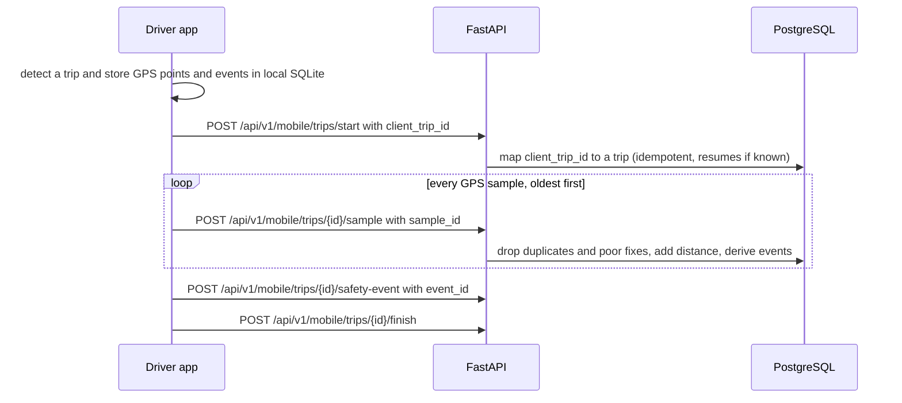

# Architecture

Describes the code as it stood at the end of Phase 0 (November 2026). Everything here was read
from the source; numbers are what the code does, not what it intends. Sources are named so a
reviewer can check them.

## 1. Components

| Component | Technology | Code | How it runs |
|---|---|---|---|
| API | Python 3.12, FastAPI, SQLAlchemy 2, Pydantic 2 | `backend/app/` (`main.py` holds about 140 endpoints; routers in `whatsapp.py`, `hardware.py`, `vehicle_handover.py`; report code in `concept_reports.py`, `report_subscriptions.py`) | `api` service, `uvicorn app.main:app` on port 8000, behind Caddy |
| Web dashboard | React 19, TypeScript (strict), Vite, Leaflet | `web/src/` (`App.tsx` is the whole shell) | Built into static files and served by Caddy (`web` service) |
| Reverse proxy | Caddy 2 | `web/Caddyfile` | Serves the SPA, proxies `/api/*` to `api:8000`, sets security headers |
| Driver app | Flutter, Kotlin (Android) and Swift (iOS) tracking | `driver_app/` | Built by GitHub Actions; local SQLite queue; talks to the API over HTTPS |
| Manager app | Flutter, `flutter_map` | `manager_app/` | Built by GitHub Actions; same login as the dashboard |
| Tracker receiver | asyncio TCP server, Teltonika Codec 8 / 8E | `backend/app/teltonika_receiver.py`, `hardware.py` | `teltonika` service, port 5027, bound to `127.0.0.1` unless configured |
| Report scheduler | Python loop | `backend/app/report_subscriptions.py` | `report_scheduler` service; checks for due email reports every 30 seconds |
| Database | PostgreSQL 16 | models in `backend/app/models.py` plus SQL executed at import time | `db` service with a named volume |

## 2. Request path and the main data flow

What the server does with each sample (`submit_sample` in `main.py`):

- Rejects fixes with accuracy worse than 50 m, capture times more than 30 s in the future or
  14 days in the past, and samples older than the newest accepted one (the client must upload
  oldest first).
- Stores a receipt per `(trip_id, sample_id)`, so a retry after a lost response never double
  counts. Samples closer than 0.7 s to the previous one are acknowledged but ignored.
- Adds point-to-point distance only when both fixes have accuracy of 30 m or better and the step is
  between 5 m and `min(80 m/s x elapsed, 1000 m)` and speed-plausible. This filters stationary
  jitter and GPS jumps.
- Detects speeding (company threshold, plus an "excessive" margin), harsh acceleration and
  braking (the reported acceleration must agree within 2 m/s2 with the speed change between
  consecutive GPS points, otherwise it is discarded), harsh cornering (heading change over three
  points) and geofence events.
- Applies per-company GPS-quality conditions (accuracy, fix age, HDOP, satellites). When
  enforcement is on and metadata is missing, the event is **not** recorded (fails closed) but the
  location is still stored.
- Records at most one event per type per trip every 30 seconds.

## 3. Identity and access

- **Roles:** `super_admin`, `workshop_staff`, `company_admin`, `fleet_manager`, `representative`,
  `driver` (`backend/app/auth.py`). Company scoping is enforced on the server (`scope()`), not in the UI.
- **Dashboard login:** email and password. Passwords use PBKDF2-SHA256 with 600,000 rounds; a
  dummy hash is verified for unknown accounts so timing does not reveal them. The access token
  is an HMAC-SHA256 signed `body.signature` token valid for 8 hours, kept in `sessionStorage`.
- **Driver login:** phone or Iqama number plus password plus an app-install `device_id`. Each
  driver is locked to **one device session** (`driver_device_sessions`); logging in elsewhere
  or a manager's "release" revokes the old one. Driver tokens carry the session id; refresh
  tokens last 30 days.
- **Brute-force protection:** database-backed rate limits on login, reset and email-change
  endpoints (`auth_limits.py`); identifiers are stored only as HMAC digests.
- **Secrets:** `NUQATI_AUTH_SECRET` (at least 32 characters) signs every token. Changing it
  signs everyone out.

## 4. Data model

- **ORM models** (`models.py`): companies, drivers (+ metadata), vehicles, trips, odometer
  readings, maintenance schedules, users, driver accounts and device sessions, driving events,
  driver locations, per-company driving settings and event conditions, app settings,
  account invitations.
- **Tables created by raw SQL at import time** (`CREATE TABLE IF NOT EXISTS` in `main.py`,
  `hardware.py`, `report_subscriptions.py`): audit and evidence tables (privacy requests and
  audit, lifecycle, notification, tracking heartbeat, safety observations, admin trip actions),
  trip numbering and client-ID / sample / event receipts, driver service history, dashboard
  account tokens, workshop assistance requests, mobile diagnostics, telematics devices and
  points, report email subscriptions, and the auth rate-limit table (`auth_limits.py`).
  `vehicle_handover.py` defines its own ORM tables, including photos stored as binary rows.
- **No migration tool.** The schema is "whatever the code creates at startup". The SQL uses
  PostgreSQL features (`BIGSERIAL`, `ON CONFLICT`, `ADD COLUMN IF NOT EXISTS`), so SQLite works
  only for a subset of tests.
- **Settings as JSON:** per-company policies and live-share tokens live in `app_settings` under
  keys such as `safety_score_policy:{company_id}`, `flexible_rag_policy:{company_id}` and
  `live_share:{sha256(token)}`.

## 5. Scoring

- **Safety score v1** (`score_policy`): five event categories with integer weights that must
  total 100 (defaults: acceleration 20, braking 20, cornering 20, speeding 25, excessive
  speeding 15), measured as events per 100 km. Below the minimum distance (20 km by default) the
  API returns `score: null` with `reason: insufficient_distance` (`calculate_safety_score`) instead
  of a number, so a driver with almost no driving is never shown 100.
- **Flexible RAG** is opt-in per company and lower-is-better; it is never converted to the
  100-point scale.
- **Reports:** monthly reports, a report suite (trip movement, daily trips, utilisation, daily
  RAG) with Excel / CSV / PDF export (`concept_reports.py`), and scheduled email reports.
  Fuel and engine-idle fields are intentionally empty because no source exists for them.

## 6. Background work

| Job | Where | Cadence |
|---|---|---|
| Connection monitor (offline drivers, email alerts) | thread inside the API process (`connectivity_alerts.py`) | every 60 s; a driver is overdue after 15 min without a heartbeat; failed emails retry after 5 min |
| Scheduled email reports | `report_scheduler` service | polls every 30 s |
| Tracker ingestion | `teltonika` service | continuous TCP |
| Legacy tyre-schedule backfill | API startup hook | once per start |

## 7. Privacy features

- **Privacy Mode:** a driver requests it (tracking continues while the request is pending), an
  admin approves or rejects it in the Privacy Audit screen, and the app switches native tracking
  off only after approval **and** only when no trip is running. Approval reaches the phone while
  the app UI is running or next resumes; there is no background push (see
  `docs/history/PRIVACY_APPROVAL_BOOT_RECOVERY_20261120.md`). Every toggle is written to an
  append-only audit that contains no coordinates.
- **Live-share links:** random token stored only as a hash, with expiry and revocation. The
  public endpoint returns a position only if the trip is active, the fix is under 120 s old with
  accuracy of 100 m or better, and Privacy Mode is off.
- **Retention:** the privacy policy and `docs/PRIVACY_SECURITY.md` talk about retention, but no
  automatic deletion job exists yet (see section 9).

## 8. External services

| Service | Used for | Configuration |
|---|---|---|
| SMTP | Invitations, password reset, alerts, scheduled reports | `NUQATI_SMTP_*`, `NUQATI_EMAIL_FROM` |
| Meta WhatsApp | Webhook verification (`/api/v1/whatsapp/webhook`) | `NUQATI_WHATSAPP_VERIFY_TOKEN`, `NUQATI_WHATSAPP_APP_SECRET` |
| MapTiler | Map tiles in web and Manager app | `VITE_MAPTILER_API_KEY` (build time), `MAPTILER_API_KEY` (Manager) |
| unpkg | Leaflet loaded inside the map iframes | allowed in the Caddy CSP |

## 9. Known constraints (not changed by Phase 0)

These are the reasons the roadmap continues after Phase 0; none is a regression.

1. **Monoliths:** `main.py` (about 4,000 lines), `web/src/App.tsx` (about 1,700 lines, 200+ `useState`)
   and `driver_app/main.dart` (about 2,900 lines), with some lines over 300 characters.
2. **Schema by import side effect:** DDL runs when the module loads, in three services, with no
   versioning or rollback.
3. **One HTTP request per GPS sample**, each doing several policy lookups; one Uvicorn process.
4. **Photos in PostgreSQL** (handover inspections): backup size and memory grow with usage.
5. **Custom token format** without key rotation; dashboard token in `sessionStorage` while the
   CSP still allows inline scripts.
6. **Tracker authentication is IMEI-only**; the network allow-list or a private APN / VPN is the
   real protection.
7. **No automatic data-retention or deletion job** for GPS history.
8. **Health check is shallow:** `/api/v1/health` always answers `ok` and does not touch the database.
9. **PDF exports are English-only** (built-in Helvetica); Arabic shaping needs an embedded font.
10. **Flutter projects are generated in CI**, not committed, so the Android package is still
    `com.example.nuqati_driver` and builds depend on patch scripts inside the workflows.
